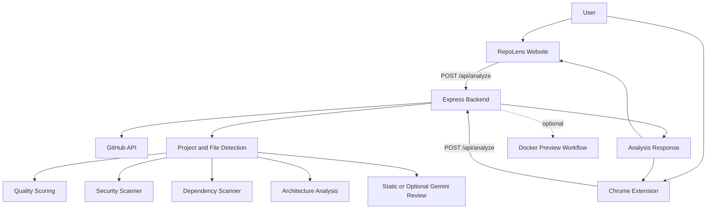

# RepoLens

**Analyze GitHub repositories from a Chrome extension or the RepoLens website.**

RepoLens is a TypeScript monorepo with an Express API, a Chrome Manifest V3 extension, shared data contracts, and a standalone website. It inspects public GitHub repositories and presents project information, quality indicators, architecture, security checks, dependency checks, and code-review findings.

- **Website:** https://repolens-lln8.onrender.com
- **Backend health:** https://repolens-backend-gkdm.onrender.com/health
- **Repository:** https://github.com/thulasisrinidhi2206-sn/Repolens

> Analysis is heuristic and sample-based. It is intended to help explore a repository, not to certify code quality or security.

## Contents

- [Features](#features)
- [How it works](#how-it-works)
- [Technology stack](#technology-stack)
- [Repository structure](#repository-structure)
- [Requirements](#requirements)
- [Run locally](#run-locally)
- [Build and test](#build-and-test)
- [Chrome extension setup](#chrome-extension-setup)
- [API reference](#api-reference)
- [Deployment](#deployment)
- [Configuration](#configuration)
- [Known limitations](#known-limitations)
- [License](#license)

## Features

### Repository analysis

- Accepts public GitHub repository URLs and supported branch URLs.
- Detects project type and framework from repository metadata and files.
- Reports repository information, sampled files, and analysis metrics.
- Produces a heuristic code-quality score and summary.

### Architecture insights

- Detects likely project modules and entry points from repository structure.
- Returns architecture information for the extension and website to visualize.
- The diagram represents detected structure; it does not prove runtime dependencies or execution flow.

### Security and dependency checks

- Checks sampled source files and repository paths for selected exposed-secret patterns and risky constructs.
- Inspects root `package.json` dependency declarations.
- Includes a small, deterministic list of known dependency advisories.

### Code review

- Runs a deterministic static review.
- Optional Gemini-assisted review is available when `GEMINI_API_KEY` is configured on the backend.
- The API does not require a Gemini key to perform its core analysis.

### Reports and history

- The Chrome extension can download Markdown and PDF reports.
- The extension stores up to 15 recent analyses in `chrome.storage.local`.
- The website keeps a small recent-analysis history in the current browser. Website history is not synced with extension history.

### Live website preview

- After repository analysis, the website adds a **Live Website Preview** panel.
- If RepoLens detects a published demo URL, the panel attempts to display it in an embedded frame and also provides an external link. Some sites block embedding; use the external link when that happens.
- If no published demo is detected, users can request a source-based preview for supported static HTML and Vite repositories through the existing isolated Docker workflow.
- Source-based preview sessions are temporary and cleaned up after their configured lifetime.
- Source-based previews require a backend host with a working Docker daemon and a reachable preview URL. The current Render backend deployment does not provide the Docker/port-routing setup required for this workflow, so the source-build button may report that hosted preview is unavailable. Detected public demo links can still be opened independently.

## How it works



The backend retrieves repository metadata and a bounded set of files from GitHub, runs the available analyzers, and returns a structured result. The website and extension render that result in their own interfaces.

## Technology stack

| Area | Technologies |
|---|---|
| Language | TypeScript, JavaScript |
| Backend | Node.js, Express |
| Browser extension | Chrome Manifest V3, TypeScript, esbuild |
| Website | Static HTML, CSS, JavaScript |
| Shared contracts | TypeScript |
| Preview workflow | Docker |
| Tests | Node.js test runner via `tsx` |

## Repository structure

```text
Repolens/
├── backend/
│   ├── src/
│   │   ├── controllers/
│   │   ├── middlewares/
│   │   ├── routes/
│   │   └── services/
│   ├── test/
│   └── .env.example
├── extension/
│   ├── icons/
│   ├── src/
│   │   ├── background/
│   │   ├── content/
│   │   ├── popup/
│   │   └── services/
│   └── manifest.json
├── shared/
│   └── src/
├── website/
│   ├── src/
│   ├── build.js
│   └── server.js
├── docs/
├── package.json
└── package-lock.json
```

## Requirements

- Node.js 20 or later recommended.
- npm 9 or later.
- Google Chrome to load the extension.
- Docker Desktop or another Docker Engine only if you want to run repository preview sandboxes locally.
- A GitHub personal access token is optional but recommended for higher GitHub API rate limits.
- A Gemini API key is optional and only used for AI-assisted review.

## Run locally

### 1. Clone the project

The website and recent deployment work are on the `feature-improvements` branch:

```bash
git clone --branch feature-improvements https://github.com/thulasisrinidhi2206-sn/Repolens.git
cd Repolens
npm install
```

### 2. Configure the backend

The example environment file is inside `backend/` (not in the repository root).

**Windows PowerShell:**

```powershell
Copy-Item backend/.env.example backend/.env
```

**macOS / Linux:**

```bash
cp backend/.env.example backend/.env
```

Edit `backend/.env` if needed:

```env
PORT=3001
NODE_ENV=development
CORS_ORIGIN=*
# Optional: increases the GitHub API rate limit
GITHUB_TOKEN=your_github_token
# Optional: enables Gemini-assisted review
# GEMINI_API_KEY=your_gemini_api_key
```

Do not commit `backend/.env`, and never put API keys in the website or extension source.

### 3. Start the backend

From the repository root:

```bash
npm run dev:backend
```

The API listens on `http://localhost:3001`. Check:

```text
http://localhost:3001/health
```

### 4. Start the website

Open a second terminal at the repository root:

```bash
npm run dev:website
```

Open the local URL printed by the command (the default is `http://127.0.0.1:4173`). The website is static and calls the backend URL configured in `website/src/main.js`; set that URL to your local backend when developing locally if it currently points to the deployed API.

## Build and test

Run all package builds:

```bash
npm run build
```

Build individual workspaces:

```bash
npm run build:shared
npm run build:backend
npm run build:extension
npm run build:website
```

Run the backend test suite:

```bash
npm test
```

The root `npm test` script runs the backend tests. It does not run a separate website or browser end-to-end test suite.

## Chrome extension setup

1. Build the shared package and extension from the repository root:

   ```bash
   npm run build:shared
   npm run build:extension
   ``

2. For a deployed backend, set its URL before building.

   **Windows PowerShell:**

   ```powershell
   $env:REPOLENS_API_URL="https://your-backend.onrender.com"
   npm run build:extension
   ```

   **macOS / Linux:**

   ```bash
   REPOLENS_API_URL=https://your-backend.onrender.com npm run build:extension
   ```

3. Open `chrome://extensions` in Chrome.
4. Enable **Developer mode**.
5. Click **Load unpacked** and select the repository's `extension/` directory.
6. Open a public GitHub repository and use the RepoLens interface.

After rebuilding, click the extension's reload icon on `chrome://extensions`.

## API reference

The backend mounts its API routes under `/api`.

### Health

```http
GET /health
GET /api/health
```

Returns service health and runtime information.

### Analyze a repository

```http
POST /api/analyze
Content-Type: application/json
```

Request:

```json
{
  "repositoryUrl": "https://github.com/facebook/react"
}
```

A successful response uses the common API envelope:

```json
{
  "success": true,
  "data": {
    "id": "analysis-id",
    "repo": {
      "owner": "facebook",
      "repo": "react",
      "branch": "main"
    },
    "projectType": "detected-project-type",
    "framework": "detected-framework"
  },
  "timestamp": "ISO-8601 timestamp"
}
```

The actual `data` object contains additional fields depending on the repository and analysis results. Error responses use `success: false` and an `error` message.

### Create a repository preview

```http
POST /api/preview
Content-Type: application/json
```

Request:

```json
{
  "repositoryUrl": "https://github.com/owner/repository"
}
```

This endpoint requires an eligible repository and a working Docker daemon on the backend host. It can return `503` when Docker is unavailable.

### Check or stop a preview

```http
GET /api/preview/{previewId}
DELETE /api/preview/{previewId}
```

Preview session state is held by the running backend process; it is not a persistent, distributed preview store.

## Deployment

### Backend on Render

Create a Render **Web Service** connected to this repository and select the branch you want to deploy.

| Setting | Value |
|---|---|
| Runtime | Node |
| Branch | `feature-improvements` |
| Root Directory | Leave blank |
| Build Command | `npm ci --include=dev && npm run build:shared && npm run build:backend` |
| Start Command | `node backend/dist/index.js` |
| Health Check Path | `/health` |

Configure these environment variables in Render:

- `NODE_ENV=production`
- `CORS_ORIGIN=*` (for a permissive demo setup; restrict this to trusted origins before production use)
- `GITHUB_TOKEN` (optional but recommended)
- `GEMINI_API_KEY` (optional)

Render supplies the `PORT` environment variable. Do not commit or share secret values.

### Website on Render

Create a separate Render **Static Site**:

| Setting | Value |
|---|---|
| Branch | `feature-improvements` |
| Root Directory | `website` |
| Build Command | `npm run build` |
| Publish Directory | `dist` |

The website calls the backend endpoint configured in `website/src/main.js`. If the backend URL changes, update that constant and redeploy the static site. The static site does not need the GitHub or Gemini secret keys.

### Preview deployment note

The deployed analysis API can run without Docker. The optional preview endpoints need Docker access on the backend host. If the host cannot access a Docker daemon, preview creation will return an unavailable response; repository analysis remains separate.

## Configuration

| Variable | Required | Purpose |
|---|---|---|
| `PORT` | No | Backend listening port; defaults to 3001 locally. |
| `NODE_ENV` | No | Runtime environment. |
| `CORS_ORIGIN` | No | Allowed website origins; configure narrowly for production. |
| `GITHUB_TOKEN` | No | Authenticated GitHub API access and higher rate limits. |
| `GEMINI_API_KEY` | No | Optional Gemini-assisted code review. |
| `REPOLENS_API_URL` | Build-time for extension | Backend URL embedded when building the extension. |

## Known limitations

- Analysis uses bounded file sampling; it does not inspect every line of every repository.
- Quality scores are heuristic indicators, not formal quality measurements.
- Security checks use selected patterns and cannot guarantee that a repository is secure.
- Dependency advisories come from a small offline list, not a live vulnerability database or complete transitive dependency audit.
- Gemini review is optional. Without a configured key, the static analyzer is used.
- Architecture diagrams show inferred repository structure, not guaranteed runtime call relationships.
- Docker previews support eligible static HTML and Vite projects; other frameworks may be detected but are not necessarily previewable.
- Preview sessions are temporary and depend on the backend process and Docker host.
- The website and Chrome extension maintain separate browser-local history.

## License

Distributed under the MIT License. See [LICENSE](LICENSE).
